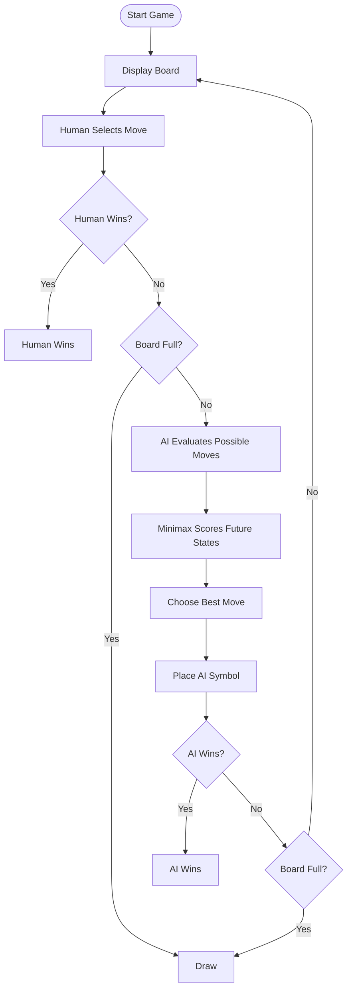

<div align="center">

# 🎮 TIC-TAC-TOE AI

### Outsmart the Human. Master the Board.

An AI-powered Tic-Tac-Toe game built with Python using the **Minimax Algorithm** for intelligent decision-making.


**Can you beat an AI that thinks ahead? 🧠**

</div>

---

## 🌟 Project Overview

**Tic-Tac-Toe AI** is a Python-based Artificial Intelligence project where a human plays against a computer-controlled opponent.

The computer uses the **Minimax algorithm** to evaluate possible moves and choose the move with the best outcome, assuming both players make optimal decisions.

Unlike a random-move game, this AI explores possible future game states before making its decision.

## ✨ Features

- 🎮 Interactive two-player-style gameplay against the computer
- 🧠 Intelligent move selection using Minimax
- 🔍 Recursive exploration of possible game states
- 🏆 Automatic winner detection
- 🤝 Draw detection
- 🛡️ Input validation to prevent invalid moves
- 📟 Simple terminal-based interface
- ⚡ No external Python libraries required

## 🎬 Game Preview

The game runs directly in your terminal.

```text
       TIC-TAC-TOE AI
       Minimax Algorithm

Position guide:

 1 | 2 | 3
---+---+---
 4 | 5 | 6
---+---+---
 7 | 8 | 9

You are X. The AI is O.

Enter a position (1-9): 5

AI is thinking...
AI chooses position 1.
```

The board updates after each move until a player wins or the game ends in a draw.

## 🧠 AI Algorithm: Minimax

Minimax is a decision-making algorithm commonly used in two-player games. It explores possible moves and assumes that both players will choose their best strategies.

### How it works

1. Generate all available moves.
2. Simulate each possible move.
3. Recursively evaluate the resulting game states.
4. Assign scores to wins, losses, and draws.
5. Select the move with the best score for the AI.

### Score System

| Game Outcome | Score |
|---|---:|
| AI wins | `+1` |
| Draw | `0` |
| Human wins | `-1` |

The AI tries to **maximize** its score, while the human player is assumed to **minimize** it.

### Minimax Flowchart



## 🛠️ Tech Stack

| Technology | Purpose |
|---|---|
| Python | Main implementation |
| Recursion | Explore future game states |
| Minimax | Choose the best AI move |
| Lists | Represent the game board |
| Conditional statements | Check wins, draws, and valid moves |

## 🚀 Getting Started

### Prerequisites

- Python 3.10 or newer recommended
- VS Code or another Python editor

No external packages are needed.

### 1. Clone the repository

```bash
git clone https://github.com/Prachipandey28/AI-Tic-Tac-Toe.git
cd AI-Tic-Tac-Toe
```

If your repository URL is different, replace it with your actual GitHub URL.

### 2. Run the game

```bash
python3 main.py
```

### 3. Play the game

- You play as `X`.
- The computer plays as `O`.
- Enter a number from `1` to `9` to select a position.
- The game announces the winner or a draw when the game ends.

## 📁 Project Structure

```text
AI-Tic-Tac-Toe/
│
├── main.py
└── README.md
```

## 📚 Concepts Learned

By completing this project, you practice:

- Game-tree exploration
- State-space search
- Recursive algorithms
- Decision-making in Artificial Intelligence
- MAX and MIN strategies
- Terminal-state evaluation
- Input validation
- Game logic implementation

## 🔮 Future Enhancements

- [ ] Build a graphical interface using Pygame.
- [ ] Add difficulty levels.
- [ ] Implement Alpha-Beta Pruning to reduce unnecessary search.
- [ ] Add a restart-game option.
- [ ] Track wins, losses, and draws.
- [ ] Display the AI's chosen move and score.
- [ ] Add game animations and sound effects.

## 👩‍💻 Author

**Prachi Pandey**

GitHub: [@Prachipandey28](https://github.com/Prachipandey28)

---

<div align="center">

### ⭐ Enjoyed this project?

Explore the code, experiment with Minimax, and consider starring the repository!

**Built with Python, strategy, and Artificial Intelligence. 🧠**

</div>